# AVAUIDesigner

   [](https://github.com/Harlock123/AVAUIDesigner/actions/workflows/build.yml)

**A visual drag-and-drop designer for [Avalonia UI](https://avaloniaui.net/) `.axaml` files.**

AVAUIDesigner works like the classic Visual Studio WinForms designer, but for Avalonia. You drag controls
from a toolbox onto a live design surface, then position, resize and align them. You set properties and
events in a property grid, and the designer writes clean, idiomatic XAML and C# for you.
It is cross-platform (Windows, macOS, Linux) and is built with .NET 10 and Avalonia 11.3.

<picture>
  <source media="(prefers-color-scheme: dark)" srcset="docs/screenshots/overview-dark.png">
  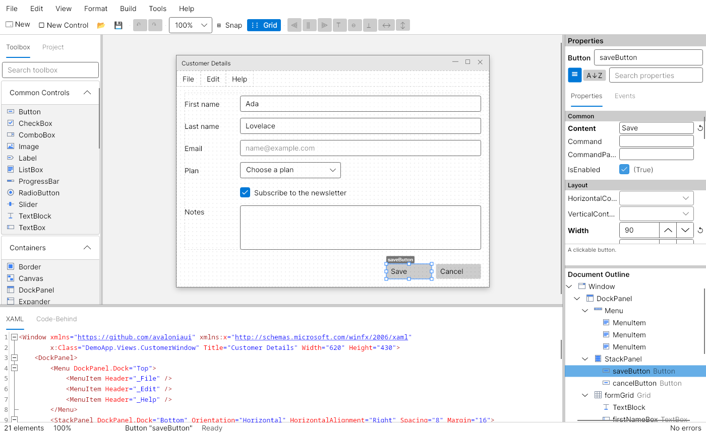
</picture>

---

## Contents

- [Highlights](#highlights)
- [Download and run](#download-and-run)
- [Getting started](#getting-started)
- [Tour](#tour)
  - [Main window](#main-window)
  - [Toolbox](#toolbox)
  - [Design surface](#design-surface)
  - [Property grid](#property-grid)
  - [Document outline](#document-outline)
  - [XAML source view](#xaml-source-view)
  - [Code-behind generation](#code-behind-generation)
  - [MVVM generation](#mvvm-generation)
  - [New documents and projects](#new-documents-and-projects)
  - [Preferences and themes](#preferences-and-themes)
- [Keyboard shortcuts](#keyboard-shortcuts)
- [Supported controls](#supported-controls)
- [Extending with plugins](#extending-with-plugins)
- [Architecture](#architecture)
- [Building and testing](#building-and-testing)
- [Design notes](#design-notes)
- [License](#license)

---

## Highlights

- **Real WYSIWYG preview.** Controls on the surface are real Avalonia controls rendered with the current
  Fluent theme, so the design looks like the running app.
- **Layout-aware placement.** The designer understands Canvas (`Canvas.Left/Top`), Grid (`Grid.Row/Column` plus
  a margin), StackPanel, WrapPanel, DockPanel and single-child containers, and writes the right XAML for each.
- **Smart snap lines, snap-to-grid, rubber-band selection, multi-select, align and distribute**, and
  z-ordering.
- **Two-way XAML sync.** Edit on the surface or in the XAML editor and the other side follows, with syntax
  highlighting, completion and inline parse errors.
- **Code-behind generation that keeps your code.** Event handler stubs are merged into your existing `.axaml.cs`
  with Roslyn. Hand-written handler bodies are never overwritten, and handlers that are no longer used move to
  an *Orphaned Handlers* region instead of being deleted.
- **MVVM scaffolding.** Generate a CommunityToolkit.Mvvm ViewModel with `[ObservableProperty]` and `[RelayCommand]`
  members, and bind the view to it in one step.
- **Full undo/redo.** Every change goes through a command stack.
- **Project aware.** Open a `.csproj` to browse its views. Root namespaces and Avalonia build settings are
  detected, and external file changes are noticed.
- **Crash recovery, persisted layout and settings, light/dark themes, and a plugin system** for custom controls
  and property editors.

---

## Download and run

Ready-to-run builds for Windows, macOS and Linux, on both Intel/AMD and ARM, are on the
[Releases page](https://github.com/Harlock123/AVAUIDesigner/releases/tag/latest). **Latest build** is
rebuilt on every push to `main`. Each download is one self-contained executable: no .NET install is
needed.

| Platform | Archive |
|---|---|
| Windows | `AVAUIDesigner-win-x64.zip`, `AVAUIDesigner-win-x86.zip`, `AVAUIDesigner-win-arm64.zip` |
| macOS | `AVAUIDesigner-osx-arm64.tar.gz` (Apple silicon), `AVAUIDesigner-osx-x64.tar.gz` (Intel) |
| Linux | `AVAUIDesigner-linux-x64.tar.gz`, `AVAUIDesigner-linux-arm64.tar.gz`, `AVAUIDesigner-linux-arm.tar.gz` |

```bash
tar -xzf AVAUIDesigner-linux-x64.tar.gz     # or linux-arm64, linux-arm, osx-arm64, osx-x64
./AVAUIDesigner                             # or ./AVAUIDesigner path/to/View.axaml
```

On Windows, unzip and run `AVAUIDesigner.exe`. On macOS, if Gatekeeper refuses to open it, run
`xattr -d com.apple.quarantine AVAUIDesigner` once.

---

## Getting started

### Requirements

- [.NET 10 SDK](https://dotnet.microsoft.com/download)
- Windows 10+, macOS 12+ or a Linux desktop (X11 or Wayland via XWayland)

### Run

```bash
git clone https://github.com/Harlock123/AVAUIDesigner.git
cd AVAUIDesigner
dotnet run --project src/AVAUIDesigner.App
```

You can also open a file or a whole project directly:

```bash
dotnet run --project src/AVAUIDesigner.App -- path/to/MainWindow.axaml
dotnet run --project src/AVAUIDesigner.App -- path/to/MyApp.csproj
```

### Publish a standalone build

The [Build workflow](.github/workflows/build.yml) builds and tests every push, then publishes single-file
executables for all eight platforms. A `v*` tag (for example `v1.0.0`) makes a versioned release. To build one
locally:

```bash
dotnet publish src/AVAUIDesigner.App -c Release -r win-x64 --self-contained \
  -p:PublishSingleFile=true -p:IncludeNativeLibrariesForSelfExtract=true -p:EnableCompressionInSingleFile=true
```

---

## Tour

### Main window

The window is split into four resizable areas. You can show or hide each one from the **View** menu, and the
layout is remembered between sessions.

| Area | Purpose |
|---|---|
| **Toolbox** (left) | Controls you can drag onto the surface, plus a **Project** tab listing the views in an opened `.csproj` |
| **Design surface** (centre) | The live, editable preview of the document |
| **Properties / Events** (right, top) | Edit the selected control |
| **Document outline** (right, bottom) | The element tree |
| **Source** (bottom) | XAML, generated code-behind and, for MVVM documents, the ViewModel |

The status bar shows the element count, zoom level, cursor position, the current selection and any XAML errors.

### Toolbox

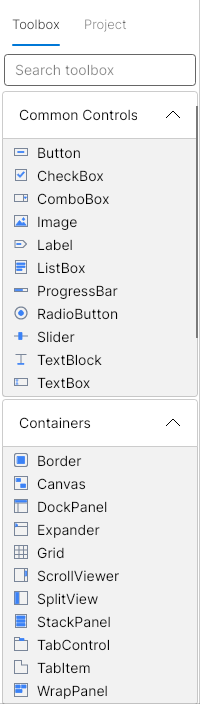

The toolbox lists every standard control in collapsible categories: *Common Controls, Containers, Data,
Menus & Toolbars, Dialogs & Overlays, Input, Layout* and *Media & Display*. Each control has its own vector icon.

- **Drag** a control onto the surface to drop it exactly where you release it, or **double-click** it to add it to
  the selected container.
- **Search** filters the list as you type.
- Dropped controls get a sensible default size and content, and are named automatically (`button1`,
  `textBox1`…) unless you turn that off.
- *Attach-on-drop* items such as **ContextMenu**, **Flyout** and **ToolTip** attach to the control you drop them
  on instead of being added as children.
- Controls from [plugins](#extending-with-plugins) appear in their own categories.

<br clear="right">

### Design surface

The root Window or UserControl is drawn as a framed window with a title bar on a dotted design grid. Selecting
a control shows its name tag and eight resize handles.

#### Smart snap lines

While you move or resize, guides appear when an edge or centre lines up with a nearby control or the
container. Snap-to-grid (default 8 px) can be combined with them or turned off from the toolbar.

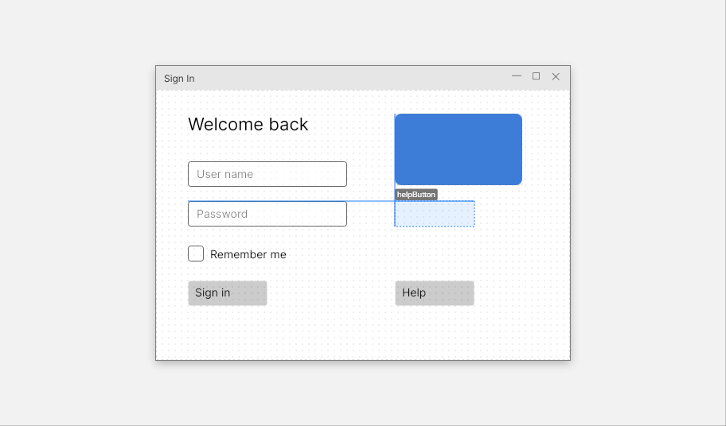

#### Rubber-band selection and multi-select

Drag on empty space to select every control inside the rectangle. **Ctrl/Shift-click** adds to or removes from the
selection, and **Tab** cycles through elements. With several controls selected, use **Format › Align**
(lefts, centres, rights, tops, middles, bottoms) and **Distribute** (horizontally or vertically), or move and
nudge them together.

<table>
  <tr>
    <td>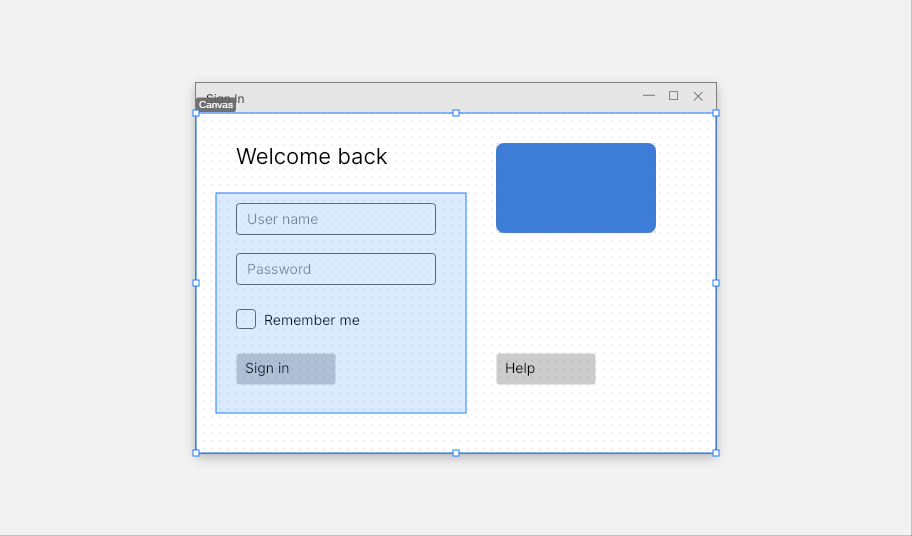</td>
    <td>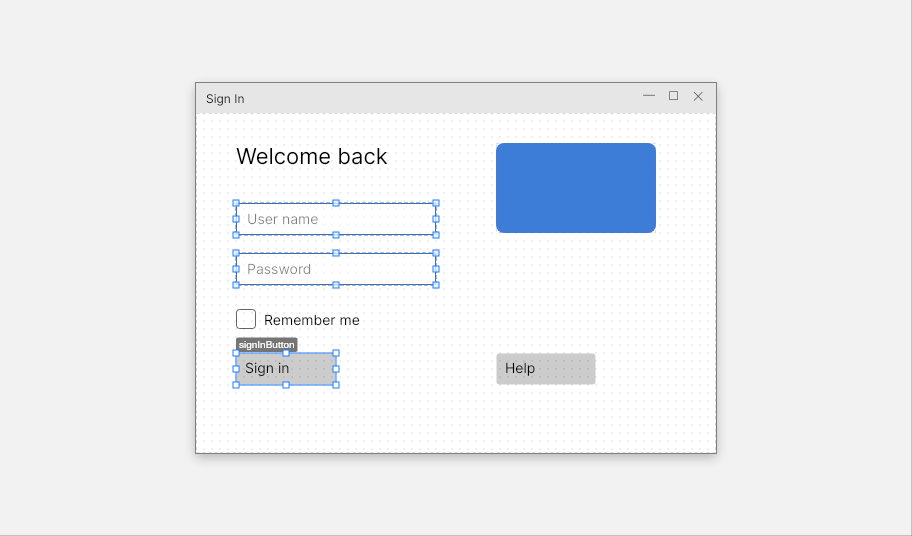</td>
  </tr>
  <tr>
    <td align="center"><em>Rubber-band selection</em></td>
    <td align="center"><em>Multi-selection</em></td>
  </tr>
</table>

#### Layout-aware drop targets

Dragging a control over a container highlights where it will land. Over a **Grid**, the target cell is
highlighted, and on drop the designer writes `Grid.Row`/`Grid.Column` plus a margin for the offset inside the
cell. Over a **StackPanel**, **WrapPanel** or **DockPanel**, an insertion marker shows the new position. Moving a
control out of a container and into another reparents it, and the old layout properties are cleaned up.

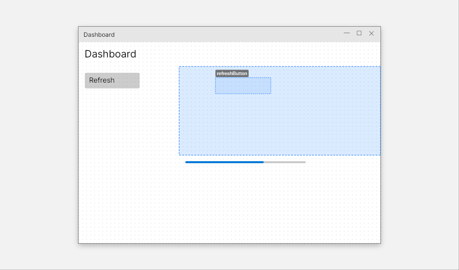

#### More surface features

- **Zoom** from 10 % to 800 % (the toolbar presets, `Ctrl+=` / `Ctrl+-`, `Ctrl+0`, or *Zoom to Fit*).
- **Context menu**: cut/copy/paste/delete, z-order, *Wrap In* (Grid, StackPanel, Border, ScrollViewer), *Unwrap*,
  *Set Tab Index*, *Set x:Name*, *Lock / Unlock* and *View XAML for Selection*. The **Edit** and **Format**
  menus add *Duplicate*, *Wrap In › Canvas* and *Group in Grid*.
- **Double-click** a control to create and jump to its default event handler (for example `Click` on a Button).
- **Locked** controls can't be moved or resized by accident.
- Overlay controls such as Popup and Flyout are shown as inert placeholders, so they don't cover the design.

### Property grid

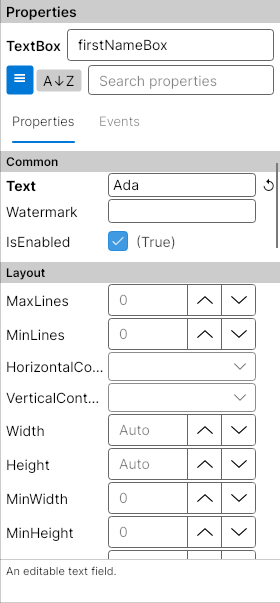

The **Properties** tab shows every designable property of the selection, either grouped by category
(*Common, Layout, Appearance, Text, Behavior…*) or sorted alphabetically, with a search box. Each property has
an editor that fits its type:

- Text, numbers (with spinners), booleans and enums
- Colours and solid brushes (with a colour picker)
- Thickness and corner radius (four linked boxes), fonts, and grid lengths
- A XAML editor dialog for complex values such as gradient brushes, templates and bindings

Attached properties such as `Grid.Row` or `DockPanel.Dock` appear when the parent supports them.

Properties that are set appear in **bold** with a reset button. Values you type are validated and written
back as XAML. With several controls selected, the grid edits the properties they share.

<br clear="right">

<table>
  <tr>
    <td width="50%" valign="top">
      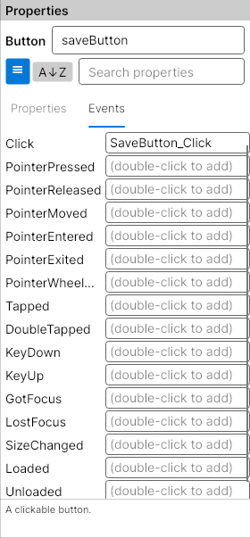
    </td>
    <td width="50%" valign="top">
      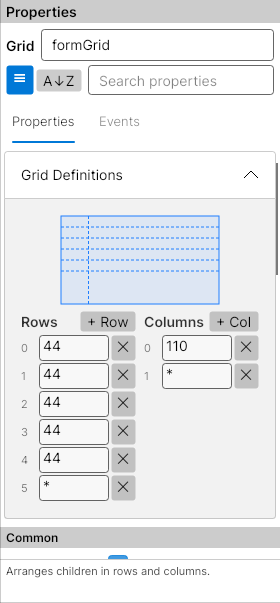
    </td>
  </tr>
  <tr>
    <td valign="top"><strong>Events tab.</strong> Double-click an event to generate a handler with the
    standard name (<code>SaveButton_Click</code>), or type your own name. Wired handlers can be opened
    directly in the code-behind.</td>
    <td valign="top"><strong>Grid definitions.</strong> Selecting a Grid shows a visual editor where you can
    add, remove and resize rows and columns (<code>Auto</code>, <code>*</code>, <code>2*</code> or pixel values).</td>
  </tr>
</table>

### Document outline

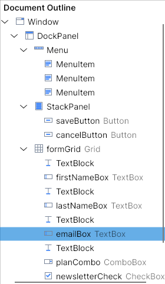

The outline shows the whole element tree with icons, names and types. Selection stays in sync with the
surface in both directions, which makes it the easiest way to reach controls that are hidden, very small or
stacked on top of each other.

- **Drag and drop** nodes to reorder or reparent them.
- Right-click for the same commands as the surface context menu.

<br clear="right">

### XAML source view

The source pane under the surface holds the XAML, kept in sync with the designer:

- Changes on the surface update the text right away, and the caret jumps to the selected element.
- Typing in the editor re-parses after a short pause. If the XAML is invalid, the error line is underlined
  and the surface keeps showing the last good version until you fix it.
- `Ctrl+Space` offers element and attribute completion, and syntax highlighting adapts to the theme.

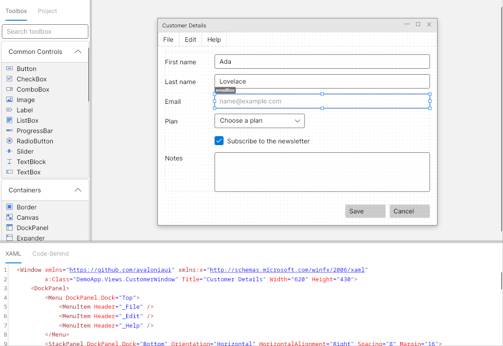

The serializer writes tidy, predictable XAML. Attributes are written in a consistent order (name first, then
layout, then the rest), default values are left out, `xmlns` prefixes are kept, and elements the designer
doesn't recognise are preserved as they are. XML comments are not preserved yet.

### Code-behind generation

When you save, AVAUIDesigner writes the matching `.axaml.cs`. If the file already exists, it is **merged rather
than overwritten**:

- New handlers are added as stubs inside the `Event Handlers` region.
- Existing handler bodies, and any other code you wrote, are left untouched.
- Handlers that are no longer referenced from the XAML are moved to an `Orphaned Handlers` region, so you never
  lose code.

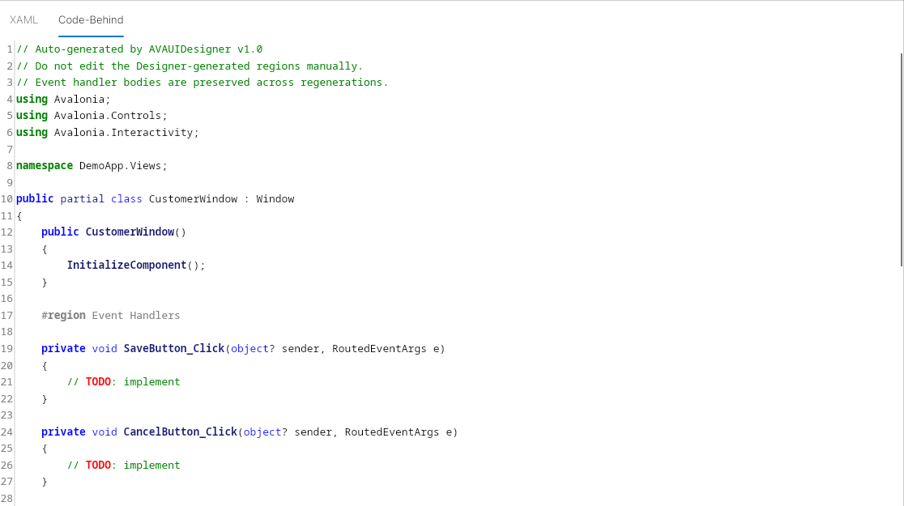

By default, events are wired with XAML attributes (`Click="SaveButton_Click"`), and fields for named controls
come from Avalonia's own source generator. Both can be changed in [Preferences](#preferences-and-themes); see
the [design notes](#design-notes).

### MVVM generation

A document can be created as MVVM, or an existing one converted with **Build › Convert to MVVM**.
**Apply MVVM Bindings** then reads your named controls and generates a CommunityToolkit.Mvvm ViewModel:

- `TextBox.Text`, `CheckBox.IsChecked`, `ComboBox.SelectedItem`, `Slider.Value`… become `[ObservableProperty]`
  fields.
- Buttons become `[RelayCommand]` methods.
- The XAML gets the matching `{Binding …}` expressions, plus `x:DataType` for compiled bindings.

Regenerating keeps the code you have written in the ViewModel.

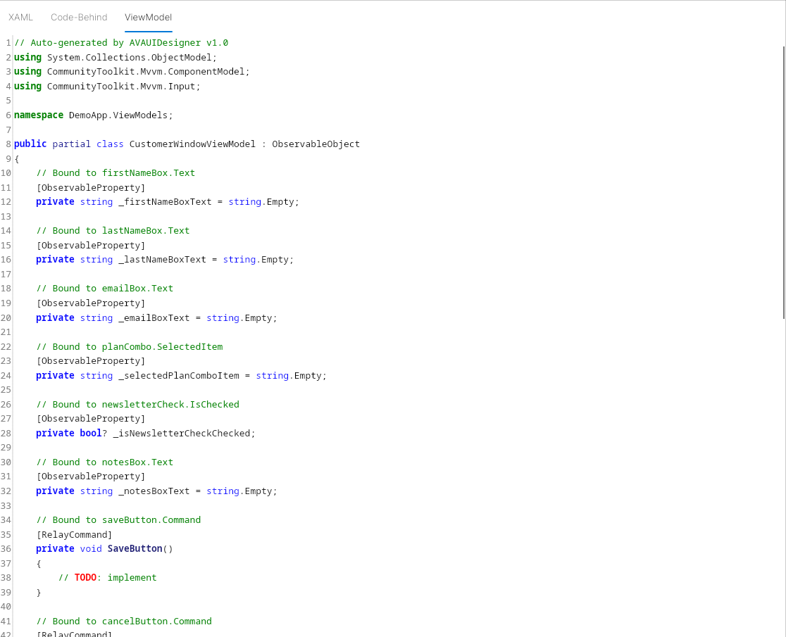

### New documents and projects

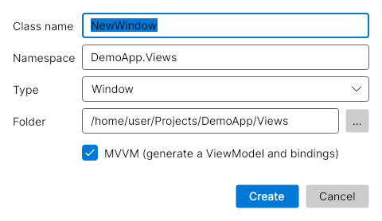

**File › New** creates a Window or UserControl, either plain or MVVM. You choose the class name, namespace and
target folder, and the `.axaml`, `.axaml.cs` and (for MVVM) ViewModel files are created together.

**File › Open Project…** loads a `.csproj`. The **Project** tab then lists its views, the project's root namespace
is used for new files, and settings such as `AvaloniaNameGeneratorIsEnabled` are picked up automatically.

If a file you have open changes on disk, the designer offers to reload it. If the app crashes, your unsaved
work is offered back the next time it starts.

<br clear="right">

### Preferences and themes

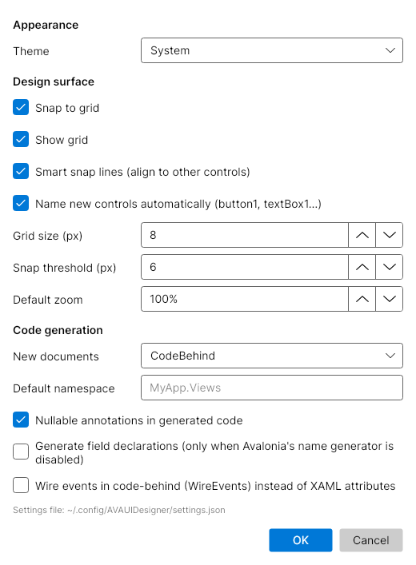

**Tools › Preferences** controls:

- **Theme:** System, Light or Dark (Fluent)
- **Design surface:** snap to grid, grid visibility, smart snap lines, automatic naming, grid size, snap
  threshold and default zoom
- **Code generation:** code-behind or MVVM for new documents, the default namespace, nullable annotations,
  whether to generate field declarations, and whether to wire events in code (`WireEvents()`) instead of XAML
  attributes

Settings are stored in JSON in your user configuration folder:

| OS | Location |
|---|---|
| Windows | `%APPDATA%\AVAUIDesigner\settings.json` |
| macOS / Linux | `~/.config/AVAUIDesigner/settings.json` |

<br clear="right">

---

## Keyboard shortcuts

| Shortcut | Action | | Shortcut | Action |
|---|---|---|---|---|
| `Ctrl+N` | New window | | `Arrows` | Nudge 1 px |
| `Ctrl+O` | Open | | `Shift+Arrows` | Nudge 8 px |
| `Ctrl+S` | Save | | `Tab` | Select next element |
| `Ctrl+Shift+S` | Save as | | `Esc` | Deselect / cancel drag |
| `Ctrl+Z` | Undo | | `F2` | Set `x:Name` |
| `Ctrl+Y` / `Ctrl+Shift+Z` | Redo | | `Ctrl+G` | Group in Grid |
| `Ctrl+X` / `C` / `V` | Cut / copy / paste | | `Ctrl+]` / `Ctrl+[` | Bring to front / send to back |
| `Ctrl+D` | Duplicate | | `Ctrl+=` / `Ctrl+-` | Zoom in / out |
| `Delete` | Delete selection | | `Ctrl+0` / `Ctrl+Shift+0` | Zoom 100 % / fit |
| `Ctrl+A` | Select all | | `Ctrl+Space` | XAML completion |
| Double-click control | Create default event handler | | `F12` | Go to handler in code-behind |

On macOS, `Cmd` works in place of `Ctrl`. **Help › Keyboard Shortcuts** shows this list in the app.

---

## Supported controls

54 standard Avalonia controls are supported, each with a descriptor that defines its properties, events,
default size and how it holds children.

| Category | Controls |
|---|---|
| Common Controls | Button, CheckBox, ComboBox, Image, Label, ListBox, ProgressBar, RadioButton, Slider, TextBlock, TextBox |
| Containers | Border, Canvas, DockPanel, Expander, Grid, ScrollViewer, SplitView, StackPanel, TabControl, TabItem, WrapPanel |
| Data | DataGrid, DataGridTextColumn, ItemsControl, ListBoxItem, ComboBoxItem, TreeView, TreeViewItem |
| Menus & Toolbars | Menu, MenuItem, ContextMenu, ToolTip |
| Dialogs & Overlays | Popup, Flyout |
| Input | AutoCompleteBox, CalendarDatePicker, DatePicker, TimePicker, NumericUpDown, ToggleButton, ToggleSwitch |
| Layout | GridSplitter, Separator, UniformGrid, Viewbox |
| Media & Display | Rectangle, Ellipse, Line, Path, Polygon, Polyline |
| Root | Window, UserControl |

Custom controls from your own namespaces (`xmlns:local="using:MyApp.Controls"`) are loaded and preserved, and
plugins can make them fully designable.

---

## Extending with plugins

Drop a .NET assembly into the `Plugins` folder next to `settings.json` (for example
`~/.config/AVAUIDesigner/Plugins/*.dll`) and it is loaded at startup. A plugin can add designable controls, toolbox categories and property editors:

```csharp
using AVAUIDesigner.Engine.Descriptors;
using AVAUIDesigner.Engine.Plugins;

public class GaugePlugin : IControlDescriptorPlugin
{
    public string PluginName => "Gauges";
    public string PluginVersion => "1.0";

    public IEnumerable<ControlDescriptor> GetDescriptors() =>
    [
        new ControlDescriptor("RadialGauge", typeof(MyControls.RadialGauge), "Gauges")
        {
            Description = "A radial gauge.",
            DefaultSize = new Avalonia.Size(120, 120),
            Properties = [new PropertyDescriptor("Value", typeof(double))],
        },
    ];

    public IEnumerable<ToolboxCategory> GetToolboxCategories() => [];
}
```

`IPropertyEditorPlugin` registers a custom editor control for a property type. The editor exposes a `Value`
property holding the XAML string. A plugin that fails to load is reported and skipped, so it never stops the
designer from starting.

---

## Architecture

```
AVAUIDesigner.sln
├── src/
│   ├── AVAUIDesigner.Engine     UI-independent core
│   ├── AVAUIDesigner.Controls   Control descriptors + toolbox icons
│   ├── AVAUIDesigner.Shell      Avalonia UI: windows, views, view models
│   └── AVAUIDesigner.App        Entry point, DI, themes, crash recovery
├── tests/
│   ├── AVAUIDesigner.Engine.Tests   xUnit
│   └── AVAUIDesigner.Shell.Tests    xUnit + Avalonia.Headless (real rendering)
├── docs/screenshots/            README images (generated)
└── scripts/update-screenshots.sh
```

| Project | Contents |
|---|---|
| **Engine** | The design document model (`DesignDocument` / `DesignElement` / `DesignProperty`), XAML parser and serializer, value conversion, undo/redo commands, selection, code-behind and ViewModel generation (Scriban templates plus a Roslyn merge), project context, settings and the plugin loader |
| **Controls** | One `ControlDescriptor` per standard control: properties, events, attached properties, default values, layout mode and icon |
| **Shell** | Main window, `DesignCanvas` (rendering, hit testing, adorners, snapping, drag and drop), toolbox, property grid and editors, outline, AvaloniaEdit source view, dialogs and services |
| **App** | `Program` / `App`: dependency injection, Fluent theme, crash recovery hooks |

Key ideas:

- **XAML strings are the source of truth.** Property values are stored as the XAML text you would write, so
  round-tripping is lossless and unknown values survive untouched.
- **Every change is an `IDesignCommand`** on the undo/redo stack: add, remove, move, resize, set property,
  rename, reparent, composite and more.
- **Placement is delegated to the container.** Each layout mode (Canvas, Grid, Stack, Dock, Wrap, Single, Items)
  turns a drop point into the right attached properties or insertion index.

Built with [Avalonia](https://avaloniaui.net/), [AvaloniaEdit](https://github.com/AvaloniaUI/AvaloniaEdit),
[ReactiveUI](https://www.reactiveui.net/), [Roslyn](https://github.com/dotnet/roslyn),
[Scriban](https://github.com/scriban/scriban) and
[CommunityToolkit.Mvvm](https://github.com/CommunityToolkit/dotnet) (generated code).

---

## Building and testing

```bash
dotnet build
dotnet test
```

- **Engine tests:** around 300 tests covering parsing, serialization and round-tripping, value conversion, undo/redo,
  and code-behind and ViewModel generation (including merging into existing code).
- **Shell tests:** these run the real main window headlessly with Skia rendering and simulate mouse and keyboard
  input. They cover dragging, resizing, rubber-band selection, toolbox drops, Grid and StackPanel drops,
  copy/paste, wrap/unwrap, alignment, property editing, XAML editing, MVVM conversion, external file changes and
  opening projects.
- **Generated-project build test (opt-in):** saves the designer's output into two real Avalonia projects, one for
  each event and field wiring mode, and compiles them with `dotnet build`:

  ```bash
  AVAUIDESIGNER_BUILD_TEST=1 dotnet test tests/AVAUIDesigner.Shell.Tests --filter GeneratedProjectBuildTests
  ```

### Regenerating the screenshots

Every image in this README is rendered by the headless test suite from sample documents. Nothing is captured
by hand, so the images can be refreshed after UI changes:

```bash
./scripts/update-screenshots.sh
```

---

## Design notes

AVAUIDesigner follows its original specification, with a few deliberate deviations:

- **Event wiring and fields.** Avalonia projects already generate fields for `x:Name` and `InitializeComponent`,
  and wiring an event both in XAML *and* in a `WireEvents()` method would run every handler twice. By default,
  events are therefore wired with XAML attributes and no fields are emitted. If a project sets
  `<AvaloniaNameGeneratorIsEnabled>false</AvaloniaNameGeneratorIsEnabled>`, the designer detects it and generates
  the fields and `InitializeComponent` itself. *Preferences* can switch to `WireEvents()` wiring, and the XAML
  attribute is then left out. Both modes are compile-tested.
- **Panels** can be resized with splitters and shown or hidden, but they don't float as separate windows.
- **Grid drops** highlight the target cell while you drag, rather than opening a separate row/column picker.
- **Skipped controls:** `DrawingPresenter` doesn't exist in Avalonia 11, and `ContentDialog` would need the
  FluentAvalonia library.
- **Property editors** are code-built controls (`Shell/Controls/PropertyEditors`) rather than separate `.axaml`
  files.

Crash-recovery snapshots are kept in `{Temp}/AVAUIDesigner/`.

---

## License

AVAUIDesigner is released under the [MIT License](LICENSE). Copyright © 2026 Lonnie Watson.
